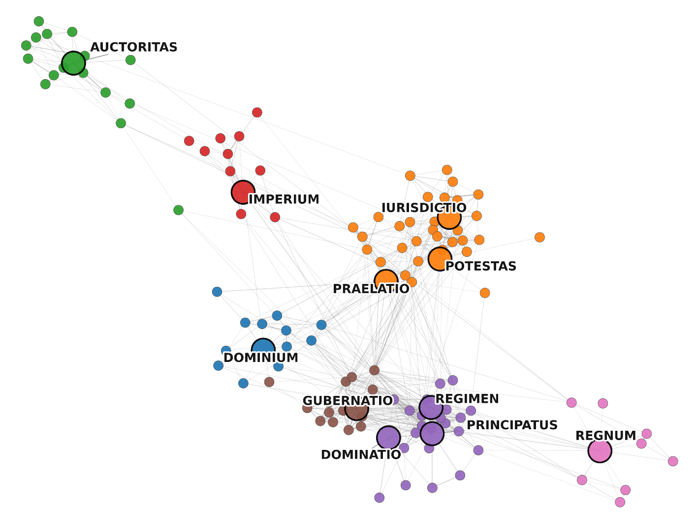
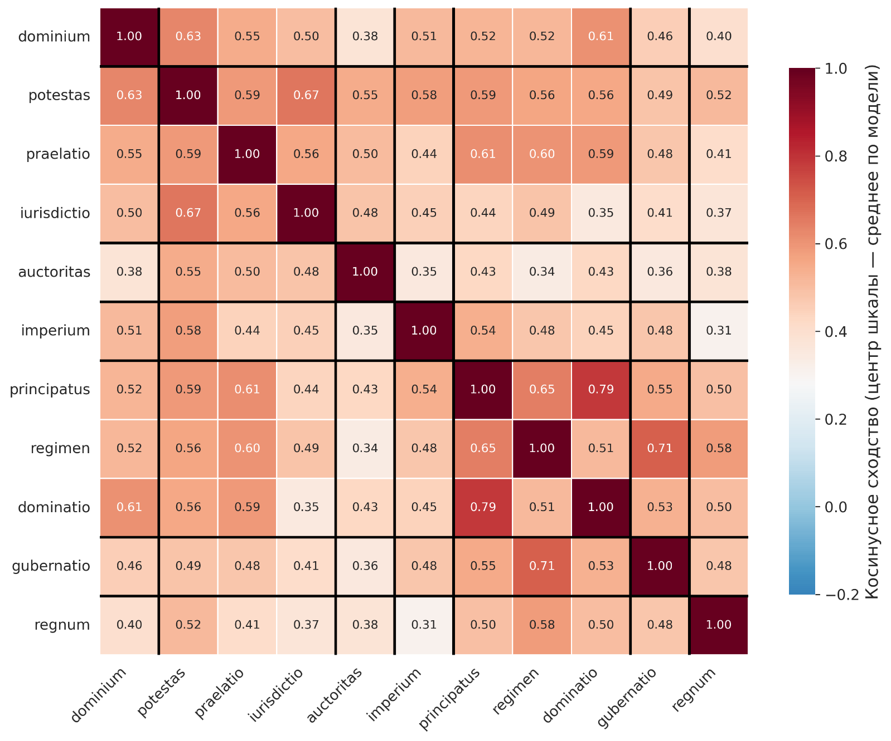
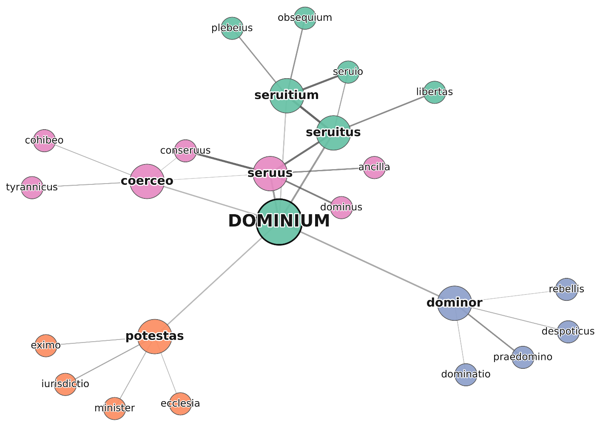
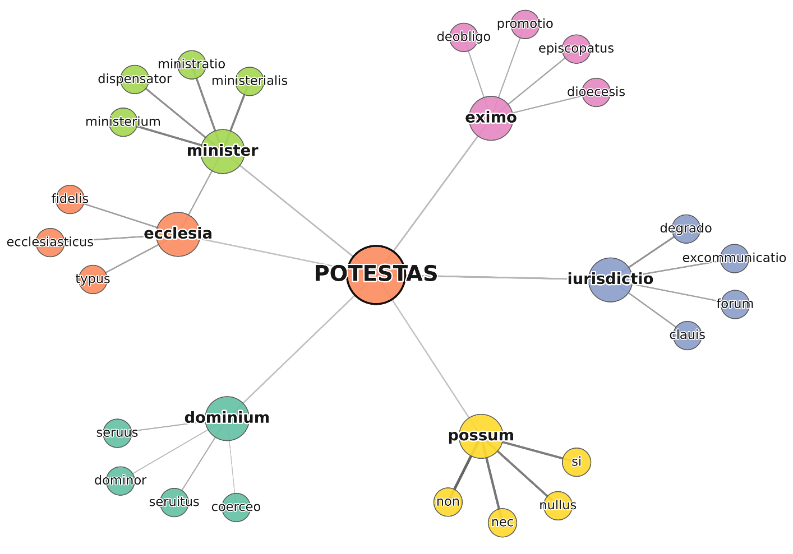
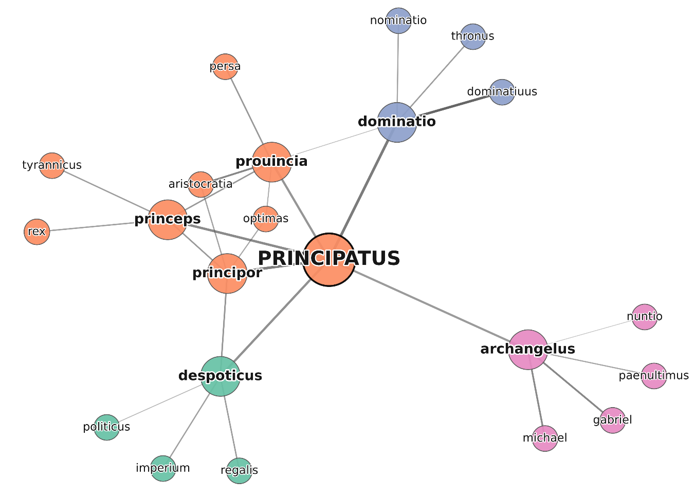

**Введение**

Для обозначения власти, начальствования и правления Фома Аквинский использует в своих богословских сочинениях ряд латинских слов: *dominium, potestas, praelatio, iurisdictio, regimen, gubernatio, principatus, dominatio, regnum, auctoritas* и *imperium*. Значения этих слов существенно пересекаются. В «Томистском лексиконе» Л. Шютца *dominium, potestas, principatus* и *regimen* приводятся как синонимы в значении власти [30]. Так же толкует их словарь Р. Деферрари и М. И. Барри: каждое из четырёх слов дано как синоним трёх остальных [17]. Вместе с тем многие из перечисленных слов имеют и другие значения. *Potestas* означает также возможность, способность к действию и ангельский чин Властей. *Principatus* и *dominatio* называют и земную власть, и ангельские чины Начал и Господств. *Auctoritas* – это и авторство, и авторитетное суждение, приводимое в споре, и полномочие публичной власти. *Gubernatio* относится как к управлению людьми, так и к божественному управлению миром [17].

Подобная неоднозначность сказывается и на переводе сочинений Фомы. А. В. Марей в русском переводе трактата «О царстве» («О правлении князей») передаёт словом «власть» не только *potestas*, но иногда и *dominium*, а словом «правление» – и *regimen*, и *principatus*. Если же *regimen* и *principatus* стоят рядом как однородные члены предложения, второе слово он переводит как «господство» [3, с. 92].

Словари и переводы фиксируют синонимию и многозначность этих слов, но не показывают, существуют ли устойчивые различия в их употреблении. От этого зависит, насколько можно опираться на словоупотребление Фомы при истолковании его учения о власти. По отдельным определениям и рассуждениям Фомы нельзя судить, связано ли то или иное слово с определённым кругом контекстов во всём корпусе его сочинений.

Цель статьи – с помощью дистрибутивной семантики и сетевого анализа выявить устойчивые контекстные связи латинских обозначений власти в корпусе основных сочинений Фомы Аквинского (*Opera Maiora*) и сопоставить их с рассуждениями самого Фомы и с интерпретациями этих рассуждений в историографии.

**Обзор литературы**

Работы о власти у Фомы Аквинского посвящены преимущественно отдельным проблемам его учения: соотношению власти и собственности, происхождению начальствования, формам правления, отношениям духовной и светской власти. Словоупотребление рассматривается в них попутно, при истолковании конкретных положений Фомы. Нас интересуют содержащиеся в этих работах наблюдения над значениями слов, обозначающих власть, над их синонимией и смысловыми различиями.

Соотношение *dominium* и *potestas* специально исследовал М. Барбье [7]. *Dominium* относится у Фомы и к власти над людьми, и к обладанию вещами. Эти употребления сближаются в деспотическом господстве над рабом, который принадлежит господину как вещь. *Potestas* обозначает власть в более общем смысле и лежит в основании *dominium*. Оба слова Барбье считает основными обозначениями власти у Фомы. Власть над людьми Фома, по его наблюдению, обычно называет *dominium*, изредка *praelatio*, а для духовной власти предпочитает *potestas*, хотя это слово употребляется и применительно к светской власти. Барбье формулирует это различие и более категорично: духовную власть, по его словам, Фома никогда не называет *dominium* [7, p. 657–658, 660–661]. Однако в трактате «О царстве» сказано, что король должен подчиняться господству и правлению, осуществляемому через священническое служение (*dominio et regimini quod administratur per sacerdotis officium*; *De regno* I, 16). О. Бульнуа рассматривает и другие значения *dominium*: господство человека над животными и над собственными действиями, основанное на его разумной природе и свободе выбора [12].

Употребление *praelatio* обсуждалось в связи с вопросом о том, мог ли один человек начальствовать над другим до грехопадения, в состоянии невинности (*status innocentiae*). К. М. Мартинес Руис обратил внимание на синонимическое употребление *praelatio* и *dominium* в комментарии ко II книге «Сентенций». Выражение *praelatio, seu dominium* встречается в одном из возражений. В собственном ответе Фома, однако, различает два способа praelatio (duplex est praelationis modus): начальствование ради блага подвластных (ad regimen) и ради пользы самого властвующего (ad dominandum; In II Sententiarum, d. 44, q. 1, a. 3, co.). В состоянии невинности в отношениях между людьми мог существовать только первый, предполагавший руководство и наставление, но не принуждение. Мартинес Руис связывает неоднозначность употребления *praelatio* и *dominium* с ещё не вполне сложившейся политической терминологией середины XIII в., но отмечает, что Фома сознавал эту неоднозначность и проводил содержательные различия [23, p. 74–77, 81–82]. Синонимия *praelatio* и *dominium* отмечена и в обоих словарях языка Фомы [17], [30].

Обозначения правления исследовались прежде всего в связи с понятием *regimen* и учением о формах правления. М. Сенеллар подчёркивает характерное для средневековой мысли противопоставление правления (*regere*) и господства (*dominari*). Понятие правления, по его наблюдению, складывалось в противовес практике господства (*dominatio*) [31, p. 19–21]. Рассматривая трактат «О царстве», Сенеллар различает *regimen* как направляющий принцип и функцию правления и *gubernatio* как практическое осуществление управления [31, p. 161, 176]. С противопоставлением правления и господства соотносится замечание А. В. Марея о названиях носителей власти. По его мнению, *princeps* нельзя переводить словом «государь», поскольку первое обозначает отношения первенства, тогда как второе соответствует латинскому *dominus* (господин) и выражает отношения господства. В качестве эквивалентов *princeps* Марей предлагает слова «князь» и «правитель» [3, с. 91–92].

Дж. Блайт рассматривает кажущееся противоречие между похвалой царской власти в трактате «О царстве» и одобрением в «Сумме теологии» (I–II, q. 105, a. 1) смешанного правления, сочетающего монархический, аристократический и демократический элементы [11]. Блайт объясняет его тем, что Фома различает формы государственного устройства и способы осуществления власти. В комментарии к «Политике» Аристотеля Фома противопоставляет царское (*regimen regale*) и политическое (*regimen politicum*) правление. В первом случае правитель обладает полной властью (*potestas plenaria*), во втором – властью, ограниченной законами гражданской общины (*potestas coarctata*). Сходные различия Фома проводит и при употреблении слова *principatus*. Определение *politicus*, как отмечает Блайт, может обозначать и правление свободными в противоположность деспотическому господству (*principatus despoticus*), и способ правления, при котором власть ограничена законом, в противоположность царскому. Само слово *regimen* обозначает у Фомы и формы правления (*diversa regimina civitatum*), одна из которых – царство (*regnum*), и способы осуществления власти [11, p. 550, 558].

Д. Ласкомб проследил, как Фома использует представления Псевдо-Дионисия об ангельских чинах (включая Господства – *Dominationes*, Начала – *Principatus* и Власти – *Potestates*) при рассмотрении церковной иерархии. В отличие от ангелов, люди, по Фоме, обладают общей природой, поэтому церковные чины (*ordines*) различаются не по природе, а по дарованной власти (*potestas gratis concessa*). Это различие полномочий (*distinctio potestatis*) Фома связывает, в частности, с властью совершать таинства (*potestas dispensandi sacramenta*) [22].

Лексика повеления и подчинения стала одним из аргументов в споре о соотношении духовной и светской власти у Фомы. И. Т. Эшман усматривал противоречие между комментарием ко II книге «Сентенций», где обе власти признаются самостоятельными в пределах своей компетенции, и трактатом «О царстве», в котором, по его мнению, светская власть выводится из духовной и подчиняется ей. Свою интерпретацию трактата Эшман обосновывал в том числе словоупотреблением: глагол *imperare* (повелевать) он понимал в юрисдикционном смысле, а слова подчинения (*subdi, subiacere, obedire* и др.) называл «однозначно юрисдикционными». Сам трактат Эшман, указывая на неясности его текстовой традиции, считал недостаточно надёжным источником для реконструкции учения Фомы о двух властях [18, p. 177–183, 195–196, 204]. Л. Бойл указал, что духовная и светская власть описываются в трактате одним и тем же глаголом *praeesse* (стоять во главе) и одними и теми же оборотами с *imperium* (повеление, власть), причём каждая власть осуществляет руководство в собственной сфере и ради соответствующей ей цели. Бойл оспорил утверждение Эшмана об исключительно юрисдикционном смысле лексики повеления и подчинения. Её употребление, по его мнению, не доказывает подчинения светской юрисдикции духовной [14, p. 239–242, 244–246].

*Auctoritas* у Фомы употребляется как в политических рассуждениях, так и в схоластической аргументации. В римской республиканской политической традиции этот термин противопоставлялся *potestas* – формальным должностным полномочиям – и обозначал признанный авторитет и влияние, не сводимые к праву повелевать [6]. В схоластической традиции *auctoritates* называли свидетельства из признанных авторитетными сочинений, отличая их от высказываний магистров (*dicta magistralia*). Как показывает Ф. Райан, в богословии Фомы *auctoritas* связана прежде всего с авторитетом свидетельства. Бог – Автор (*auctor*) всего сущего и, в особом смысле, Священного Писания. Доводы, основанные на авторитете канонических книг, Фома признаёт необходимыми доказательствами, тогда как ссылки на учителей Церкви имеют лишь вероятную доказательную силу [29, p. 447–448, 451].

В рассмотренных исследованиях отмечены и синонимия обозначений власти у Фомы, и различия в их употреблении, но эти наблюдения сделаны преимущественно на материале отдельных сочинений и избранных фрагментов. Как обозначения власти соотносятся друг с другом в корпусе сочинений Фомы в целом и согласуется ли это соотношение с трактовками, предложенными в историографии, не выяснялось.

Подойти к решению этого вопроса позволяют методы дистрибутивной семантики, которая описывает слово через контексты его употребления. Её основной инструмент – векторные модели, или модели эмбеддингов слов (word embeddings). Обученные на латинских корпусах разных эпох и отдельных авторов, они в последние годы всё активнее применяются в исследованиях по истории латинской лексики, в том числе лексики Фомы Аквинского [1], [2], [9], [10], [15], [20], [21], [28], [32], [33]. Насколько нам известно, обозначения власти у Фомы этими методами ещё не исследовались.

**Материалы и методы**

Материалом исследования послужила векторная модель проекта LiLa, обученная на корпусе *Opera Maiora* – подкорпусе *Index Thomisticus* [32], [33]. Обучающий корпус насчитывает около 4,5 млн слов и включает «Комментарий к “Сентенциям”», «Сумму против язычников», «Сумму теологии», дискуссионные вопросы (*Quaestiones disputatae*) и кводлибеты (*Quaestiones de quolibet*) [27, p. 28].

Векторная модель представляет каждое слово вектором в многомерном пространстве. Положение вектора зависит от контекстов употребления слова в корпусе. Векторы слов со схожими контекстами располагаются рядом. Мерой близости слов служит косинусное сходство – косинус угла между соответствующими векторами. Чем выше его значение, тем более сходны контексты употребления слов. На этой мере основаны и списки ближайших соседей слова, и сети взаимных связей между словами. Однако дистрибутивная близость может отражать не только семантические, но и тематические, фразеологические, морфологические и иные особенности словоупотребления [5], [13]. Сама по себе близость векторов ещё не доказывает сходства значений слов и обозначаемых ими понятий. Выводы о семантических и понятийных отношениях требуют исторической интерпретации с опорой на тексты [5], [16], [39].

Из моделей проекта LiLa выбрана модель архитектуры fastText skip-gram размерностью 100 (файл «opera-maiora-lemmas_skip_100.bin», окно 10 лемм, минимальная частота 5, словарь 6724 леммы) [34]. Эта конфигурация показала лучший результат в тесте на выбор синонимов (86,91 %) [33]. Тест проводился только на моделях классической латыни, и сопоставимой оценки для *Opera Maiora* нет.

Тексты *Index Thomisticus* лемматизированы вручную. При подготовке корпуса к обучению модели слова приведены к нижнему регистру, пунктуация удалена, а *v* и *j* заменены на *u* и *i* [33]. Леммы в тексте, таблицах и на рисунках приводятся в написании словаря модели (*seruus, ciuitas*), цитаты из сочинений Фомы – в орфографии издания.

Анализ проводился в несколько этапов. Для каждой из одиннадцати целевых лемм определены пятнадцать ближайших соседей по косинусному сходству. Целевые леммы и их соседи без повторов составили общий словарь из 125 лемм, для всех пар которого вычислено косинусное сходство. Чтобы сопоставить полученные значения с общим распределением сходства в модели, тот же показатель рассчитан для всех 22 602 726 уникальных пар лемм её словаря. Среднее сходство составило 0,2792, стандартное отклонение – 0,1085, а 99-й перцентиль – 0,5464 (Приложение, Рисунок П1).

При построении семантической сети два узла соединяются ребром, если косинусное сходство между ними достигает заданного порога. При низких значениях порога почти все леммы связаны друг с другом. Так, при пороге 0,30 граф содержит 6362 ребра из 7750 возможных и слишком плотен для содержательной интерпретации. Порог подбирался в интервале от 0,30 до 0,80 с шагом 0,01: принималось наибольшее значение, при котором сеть ещё оставалась связной. Для словаря из 125 лемм порог составил 0,59, что выше 99-го перцентиля распределения сходства по всей модели (0,5464). Полученный взвешенный граф содержит 724 ребра. Вес каждого ребра равен косинусному сходству соответствующих векторов.

Такой порог даёт связную и обозримую сеть, но не служит универсальным критерием значимости отдельных связей. Его величину задаёт наименее связанная лемма словаря – в нашем случае *possideo* (владеть): порог равен сходству, при котором она ещё сохраняет хотя бы одну связь с остальной сетью, и при его повышении на 0,01 она от сети отделяется.

Сообщества в сети выделялись алгоритмом Лейдена [26], [36]. Поскольку алгоритм стохастичен, выполнено 50 запусков со значениями параметра случайной инициализации (seed) от 0 до 49. В качестве основного выбрано разбиение, наиболее близкое к остальным по составу пар узлов, попадающих в одно сообщество. Для оценки устойчивости подсчитывалось, сколько раз каждая из 55 возможных пар одиннадцати целевых лемм оказывалась в одном сообществе.

Для каждой целевой леммы построена также локальная семантическая сеть по двухуровневой схеме, предложенной К. Ф. Баунвиг и К. Л. Нильбо [8]: сначала отбирались шесть ближайших соседей целевой леммы, затем по четыре ближайших соседа каждого из них. Числа соседей приняты по образцу Э. и К. Врангбек [37, p. 5–6]. Сообщества в локальных сетях также выделялись алгоритмом Лейдена. Эти сети использовались для визуального представления и содержательного анализа ближайшего окружения целевых лемм.

Устойчивость результатов проверялась тремя способами. Во-первых, число ближайших соседей каждой целевой леммы изменялось с пятнадцати на десять и двадцать. Вместе со словарём менялся и порог связности, определявшийся тем же способом: сети включали соответственно 92, 125 и 164 леммы при порогах 0,60, 0,59 и 0,58.

Во-вторых, единый порог сходства заменялся отбором связей по рангу ближайших соседей (union k-NN). Ребро в сети между двумя из 125 лемм проводилось, если хотя бы одна из них входила в число восьми ближайших соседей другой. Значение k = 8 выбрано эвристически, веса рёбер остались прежними. Полученная сеть сопоставима по плотности с основной (677 рёбер против 724), хотя 155 её связей имеют сходство ниже порога 0,59.

В-третьих, для оценки влияния низкочастотных лемм из основной сети исключались 20 нецелевых слов с частотой менее десяти употреблений. Новые соседи не добавлялись, порог и веса оставшихся связей не менялись. В сети осталось 105 лемм (Приложение, Таблицы П6 и П7).

Результаты модели сопоставлены с текстами Фомы, прежде всего входящими в обучающий корпус. Для сопоставления отбирались определения самого Фомы, места, на которые опираются исследователи, и примеры, поясняющие ближайшее окружение слов. Тексты сверены по изданию *Corpus Thomisticum* [35]. Ссылки на сочинения Фомы даются по членению этого издания. Трактат «О царстве», который в обучающий корпус не входит и привлекается в связи с историографическими спорами, цитируется по тому же изданию, где воспроизведён туринский текст 1954 г. Главам I, 14–16 этого издания соответствуют главы I, 13–15 в традиционной редакции текста, использованной Эшманом и Бойлом, и главы II, 2–4 в критическом Леонинском издании 1979 г. [24, p. xiii].

Расчёты выполнены на Python с использованием библиотек gensim, NetworkX, igraph, leidenalg и scikit-learn. Код и полные результаты размещены в открытом репозитории (см. раздел «Доступность данных и кода»).

**Результаты и обсуждение**

В основном варианте сети из 125 лемм выделено семь сообществ (Таблица 1, Рисунок 1). Три из них соответствуют контекстным областям, связанным с властными отношениями между людьми: это области господства (вокруг *dominium*), должностных полномочий (вокруг *potestas – iurisdictio*, к которым при основных параметрах примыкает *praelatio*) и правления (вокруг *regimen – principatus – dominatio*). Каждая из остальных четырёх целевых лемм (*auctoritas, imperium, gubernatio, regnum*) образует собственное сообщество с иным тематическим окружением.

**Таблица 1. Сообщества основной сети (125 лемм, порог 0,59, модулярность 0,4941).** Полный состав и графы всех семи сообществ приведены в Приложении (Таблица П4, Рисунок П3).

| **№** | **Обозначения власти** | **Число лемм** | **Характерные леммы окружения** |
| --- | --- | --- | --- |
| 1 | _dominium_ (господство, владение) | 13 | _seruus_ «раб»; _seruitus_ «рабство»; _seruitium_ «рабская служба»; _coerceo_ «принуждать»; _conseruus_ «товарищ по рабству»; _mercatio_ «торговля»; _subiectio_ «подчинение»; _usurpo_ «присваивать, захватывать» |
| 2 | _potestas_ (власть), _praelatio_ (положение поставленного над другими), _iurisdictio_ (юрисдикция) | 34 | _ecclesia_ «Церковь»; _minister_ «служитель»; _episcopus_ «епископ»; _clauis_ «ключ»; _excommunicatio_ «отлучение»; _forum_ «суд, судебная инстанция»; _ordinarius_ «ординарный, установленный»; _officium_ «должность, служба» |
| 3 | _auctoritas_ (авторитет) | 17 | _subauctoritas_ «подчинённый авторитет»; _auctoritatiuus_ «авторитетный»; _solutio_ «разрешение (возражения)»; _obiectio_ «возражение»; _probatio_ «доказательство»; _expositio_ «истолкование» |
| 4 | _imperium_ (повеление) | 11 | _impero_ «повелевать»; _imperatiuus_ «повелительный»; _obedio_ «повиноваться»; _exequor_ «исполнять»; _nutus_ «мановение»; _motiuus_ «движущий» |
| 5 | _principatus_ (первенство, власть правителя), _regimen_ (правление), _dominatio_ (господствование; Господства) | 25 | _princeps_ «правитель, князь»; _rex_ «царь, король»; _ciuitas_ «гражданская община»; _aristocratia_ «аристократия»; _optimas_ «представитель знати»; _archangelus_ «архангел»; _thronus_ «престол; Престолы (ангельский чин)» |
| 6 | _gubernatio_ (управление) | 16 | _guberno_ «управлять»; _gubernatiuus_ «относящийся к управлению»; _prouidentia_ «провидение»; _prouisor_ «попечитель»; _ordinator_ «устроитель»; _prouisio_ «предусмотрение» |
| 7 | _regnum_ (царство, царская власть) | 9 | _regno_ «царствовать»; _introeo_ «входить»; _introitus_ «вход»; _aperio_ «открывать»; _ierusalem_ «Иерусалим»; _possideo_ «владеть» |

**Рисунок 1. Сеть на основе косинусного сходства одиннадцати обозначений власти и их пятнадцати ближайших соседей.** Цвет обозначает семь сообществ основного разбиения, выбранного из 50 запусков алгоритма Лейдена. Подписаны одиннадцать целевых лемм.

Проверки при разном числе соседей подтвердили устойчивость ядер контекстных областей: во всех трёх вариантах *potestas* и *iurisdictio* попадали в одно сообщество в 150 запусках из 150, *principatus* и *dominatio* – в 147, *regimen* и *principatus* – в 140 (при десяти соседях – в 40 из 50). *Dominium* ни разу не оказывалось вместе с *potestas* или *regimen*. Положение *praelatio* и *regnum*, напротив, зависит от числа соседей (Таблица 2).

**Таблица 2. Совместная принадлежность целевых лемм к сетевым сообществам при N = 10, 15 и 20 (по 50 запусков Лейдена)**

| **Пара лемм** | **N = 10** | **N = 15** | **N = 20** |
| --- | --- | --- | --- |
| _dominium – praelatio_ | 8 | 6 | 6 |
| _dominium – dominatio_ | 0 | 1 | 1 |
| _potestas – praelatio_ | 2 | 44 | 44 |
| _potestas – iurisdictio_ | 50 | 50 | 50 |
| _praelatio – iurisdictio_ | 2 | 44 | 44 |
| _praelatio – auctoritas_ | 39 | 0 | 0 |
| _principatus – regimen_ | 40 | 50 | 50 |
| _principatus – dominatio_ | 50 | 49 | 48 |
| _regimen – dominatio_ | 40 | 49 | 48 |
| _regimen – gubernatio_ | 13 | 8 | 5 |
| _principatus – gubernatio_ | 3 | 8 | 5 |
| _regimen – regnum_ | 37 | 3 | 2 |
| _principatus – regnum_ | 47 | 3 | 2 |

Сопоставление пороговой сети с сетью ближайших соседей и сетью без редких лемм показывает, какие объединения устойчивы, а какие зависят от способа построения (Таблица 3). Пары *potestas – iurisdictio*, *principatus – regimen* и *principatus – dominatio* в большинстве случаев объединяются и при отборе рёбер по восьми ближайшим соседям, и после исключения редких лемм. Сохраняется и обособленность *dominium* от ядер двух других областей: ни в одном из пяти вариантов сети *dominium* не объединялось с их леммами больше чем в 2 запусках из 50. Сообщество *regimen – principatus – dominatio* не распадается и без *aristocratia* и *optimas* (представитель знати), хотя у этих редких слов (7 и 5 употреблений) в основной сети много связей. Положение *praelatio* и *regnum* от способа построения зависит: при отборе по ближайшим соседям *praelatio* почти всегда объединяется с *dominium* (49 запусков из 50), а *regnum* – с *principatus* и *regimen*, как и в пороговой сети с десятью соседями (Таблица 2). В целом выделенные сообщества после исключения редких лемм близки к основному варианту сети: скорректированный индекс Рэнда на 105 общих узлах равен 0,85.

**Таблица 3. Совместная принадлежность целевых лемм к сообществам при трёх способах построения сети.** Полная таблица в Приложении (Таблица П6).

| **Пара лемм** | **Пороговая сеть** | **Восемь ближайших соседей** | **Без редких лемм** |
| --- | --- | --- | --- |
| _dominium – potestas_ | 0 | 2 | 0 |
| _dominium – regimen_ | 0 | 0 | 0 |
| _dominium – dominatio_ | 1 | 0 | 2 |
| _potestas – iurisdictio_ | 50 | 48 | 50 |
| _principatus – regimen_ | 50 | 49 | 46 |
| _principatus – dominatio_ | 49 | 50 | 50 |
| _regimen – dominatio_ | 49 | 49 | 46 |
| _potestas – praelatio_ | 44 | 2 | 5 |
| _praelatio – iurisdictio_ | 44 | 0 | 5 |
| _dominium – praelatio_ | 6 | 49 | 1 |
| _principatus – regnum_ | 3 | 50 | 1 |
| _regimen – regnum_ | 3 | 49 | 1 |
| _regimen – gubernatio_ | 8 | 1 | 4 |
| _principatus – gubernatio_ | 8 | 0 | 0 |

Леммы, близкие по попарному сходству (Рисунок 2), могут принадлежать разным сообществам. Сходство *dominium* и *potestas* составляет 0,632, то есть на 3,3 стандартного отклонения выше среднего по модели. Каждое из этих слов входит в пятёрку ближайших соседей другого, но при пороговом построении сети в одном сообществе они не оказывались ни разу, а в сети ближайших соседей – лишь в 2 запусках из 50 (Таблица 3). Сходство *praelatio* с *principatus* (0,612) и *regimen* (0,604) выше, чем с *potestas* (0,589), однако с *principatus* она не объединялась ни в одном из 150 запусков при трёх вариантах числа соседей, а с *regimen* – лишь в одном (Приложение, Таблица П6). Попарное сходство и принадлежность к сообществу характеризуют разные стороны контекстных связей. При выделении сообществ учитывается окружение каждого слова во всём отобранном словаре. Десять ближайших соседей каждой целевой леммы приведены в Таблице 4.

**Рисунок 2. Косинусное сходство одиннадцати целевых лемм.** Порядок слов и разделительные линии соответствуют сообществам основной сети из 125 лемм.

**Таблица 4. Десять ближайших соседей одиннадцати целевых лемм в модели *Opera Maiora***

| **Целевая лемма** | **Десять ближайших соседей** |
| --- | --- |
| _dominium_ | _seruitus_ «рабство»; _seruus_ «раб»; _dominor_ «господствовать»; _coerceo_ «принуждать»; _potestas_; _seruitium_ «рабская служба»; _dominatio_ «господствование; Господства (ангельский чин)»; _conseruus_ «товарищ по рабству»; _despoticus_ «деспотический»; _usurpo_ «присваивать, захватывать» |
| _potestas_ | _iurisdictio_; _eximo_ «изымать (из-под власти)»; _minister_ «служитель»; _dominium_; _ecclesia_ «Церковь»; _possum_ «мочь»; _episcopatus_ «епископство»; _arbiter_ «судья, посредник»; _resigno_ «слагать (полномочия)»; _sacerdotalis_ «священнический» |
| _praelatio_ | _celatio_ «сокрытие»; _subiectio_ «подчинение»; _praefero_ «ставить впереди; предпочитать»; _uelatio_ «покрытие покровом»; _plebeius_ «простолюдин; плебейский»; _ordinatio_ «упорядочивание; посвящение в сан»; _praeficio_ «ставить во главе»; _praepono_ «ставить во главе; предпочитать»; _ordinarius_ «ординарный, установленный»; _tyrannicus_ «тиранический» |
| _iurisdictio_ | _degrado_ «лишать сана»; _excommunicatio_ «отлучение»; _clauis_ «ключ»; _forum_ «суд, судебная инстанция»; _episcopus_ «епископ»; _laicus_ «мирянин»; _absolutio_ «отпущение (грехов)»; _parochialis_ «приходской»; _subdiaconatus_ «иподиаконство»; _indulgentia_ «индульгенция; снисхождение» |
| _regimen_ | _praeficio_ «ставить во главе»; _gubernatiuus_ «относящийся к управлению»; _gubernatio_; _aristocratia_ «аристократия»; _optimas_ «представитель знати»; _regitiuus_ «правящий, направляющий»; _ciuitas_ «гражданская община»; _rector_ «правитель»; _tyrannicus_ «тиранический»; _regius_ «царский, королевский» |
| _gubernatio_ | _guberno_ «управлять»; _gubernatiuus_ «относящийся к управлению»; _gubernator_ «кормчий, правитель»; _gubernatorius_ «относящийся к кормчему, к управлению»; _ordinator_ «устроитель»; _prouisor_ «попечитель»; _regimen_; _prouidentia_ «провидение»; _ordinatio_ «упорядочивание; посвящение в сан»; _coordinatio_ «согласование, соупорядочение» |
| _principatus_ | _dominatio_ «господствование; Господства (ангельский чин)»; _principor_ «начальствовать, первенствовать»; _princeps_ «правитель, князь»; _despoticus_ «деспотический»; _prouincia_ «провинция»; _archangelus_ «архангел»; _dominatiuus_ «господский»; _regalis_ «царский»; _optimas_ «представитель знати»; _aristocratia_ «аристократия» |
| _dominatio_ | _dominatiuus_ «господский»; _principatus_; _thronus_ «престол; Престолы (ангельский чин)»; _nominatio_ «именование»; _prouincia_ «провинция»; _archangelus_ «архангел»; _principor_ «начальствовать, первенствовать»; _regalis_ «царский»; _despoticus_ «деспотический»; _dominor_ «господствовать» |
| _regnum_ | _regno_ «царствовать»; _introeo_ «входить»; _regius_ «царский, королевский»; _aristocratia_ «аристократия»; _rex_ «царь, король»; _aperio_ «открывать»; _ciuitas_ «гражданская община»; _introitus_ «вход»; _regalis_ «царский»; _prouincia_ «провинция» |
| _auctoritas_ | _subauctoritas_ «подчинённый авторитет»; _auctoritatiuus_ «авторитетный»; _induco_ «приводить (свидетельство, довод)»; _assertiuus_ «утвердительный»; _solutio_ «разрешение (возражения)»; _apostolicus_ «апостольский»; _declaratio_ «разъяснение»; _tractator_ «толкователь»; _obiectio_ «возражение»; _expositio_ «истолкование» |
| _imperium_ | _impero_ «повелевать»; _imperatiuus_ «повелительный»; _obedio_ «повиноваться»; _despoticus_ «деспотический»; _exequor_ «исполнять»; _nutus_ «мановение»; _imperitus_ «несведущий, неопытный»; _motiuus_ «движущий»; _subiaceo_ «находиться под властью»; _regalis_ «царский» |

Область господства представлена в сети сообществом *dominium* из 13 лемм, в котором преобладает лексика господства и зависимости (Таблица 1; Приложение, Рисунок П3, сообщество 1). В локальной сети (Рисунок 3) тесно связаны между собой *seruus* (раб), *seruitus* (рабство) и *seruitium* (рабская служба). Вокруг них группируются другие обозначения рабского состояния и подчинения: *ancilla* (рабыня), *conseruus* (товарищ по рабству), *obsequium* (повиновение), а также противопоставленная рабству *libertas* (свобода). Другое ответвление идёт от *dominor* (господствовать), к которому примыкают *dominatio* (господствование), *praedomino* (преобладать, владычествовать), *despoticus* (деспотический) и *rebellis* (мятежный). Слово *coerceo* (принуждать) связано с *seruus*, *cohibeo* (удерживать, обуздывать) и *tyrannicus* (тиранический). Отдельную ветвь образует *potestas* с церковной лексикой, о которой речь пойдёт ниже.

**Рисунок 3. Локальная сеть *dominium*.** Крупным узлом показана целевая лемма, узлами среднего размера – шесть ближайших соседей, малыми узлами – по четыре ближайших соседа каждого из них. Цвет обозначает группы, выделенные алгоритмом Лейдена.

Преобладание лексики рабства в окружении *dominium* возвращает к вопросу о господстве человека над человеком до грехопадения. В комментарии ко II книге «Сентенций», где *praelatio* и *dominium*, как отмечалось в обзоре литературы, взаимозаменяемы, Фома различает два способа *praelatio*: начальствование ради блага подвластных (*ad regimen*) и начальствование ради пользы самого властвующего (*ad dominandum*). Второе он уподобляет власти господина над рабом и тирана над подданными (*In II Sententiarum*, d. 44, q. 1, a. 3). В «Сумме теологии» он разграничивает два значения *dominium*: в одном случае господином называется тот, кому другой человек подчинён как раб, в другом – тот, на ком лежит обязанность управлять свободными и руководить ими (*Summa theologiae* I, q. 96, a. 4). В ближайшем окружении *dominium* наиболее отчётливо представлено первое значение. Обозначения правления – *regimen, principatus* и *gubernatio* – значительно менее близки к *dominium*, чем *seruus* и *seruitus*, и входят в другие сообщества сети. Впрочем, контекстные окружения *dominium* и *principatus* пересекаются: у них есть общий ближайший сосед *despoticus*.

В сочинениях Фомы *dominium* употребляется также применительно к обладанию вещами и к власти человека над собственными действиями. В «Сумме теологии» Фома говорит о естественном господстве человека над внешними вещами (*naturale dominium exteriorum rerum*), которое проявляется в возможности пользоваться ими с помощью разума и воли (*Summa theologiae* II–II, q. 66, a. 1). В модели это значение отражено слабо. Среди пятнадцати ближайших соседей *dominium* есть *mercatio* (торговля), *iurisconsultus* (правовед) и *patrimonium* (наследственное имущество), но в локальную сеть (Рисунок 3) эти слова не попадают. Ещё менее заметно в ближайшем окружении *dominium* господство человека над собственными действиями, которое Бульнуа рассматривает в связи с учением Фомы о свободе воли [12, p. 428, 431]. Между тем Фома прямо использует выражение *dominium sui actus* (господство над собственным действием), говоря о существах, способных действовать самостоятельно (*Summa theologiae* I, q. 103, a. 5, ad 2). Не отражена в модели и связь господства с повелением (*imperium*). Над животными, по словам Фомы, человек в состоянии невинности господствовал посредством повеления (*animalibus aliis per imperium dominabatur*), а над растениями и неодушевлёнными вещами – посредством пользования (*utendo*; *Summa theologiae* I, q. 96, a. 2) [12, p. 431], но *dominium* не входит ни в ближайшее окружение *imperium*, ни в его локальную сеть.

Область должностных полномочий представлена сообществом, в которое в основной сети входят *potestas, praelatio* и *iurisdictio* (Приложение, Рисунок П3, сообщество 2). Его ядро составляет пара *potestas – iurisdictio*, устойчивая при всех проверках (Таблицы 2 и 3). Окружение *iurisdictio* почти целиком принадлежит языку церковной юрисдикции и дисциплины. К нему относятся *excommunicatio* (отлучение), *clauis* (ключ), *forum* (судебная инстанция), *episcopus* (епископ), *degrado* (лишать сана) и *absolutio* (отпущение). Среди соседей *potestas* также преобладает церковная лексика: *minister* (служитель), *ecclesia* (Церковь), *episcopatus* (епископство), *sacerdotalis* (священнический). В локальной сети *potestas* (Рисунок 4) вокруг этих слов группируются обозначения служения и церковного устройства (*ministerium, dispensator, ecclesiasticus, dioecesis*). Отдельную ветвь образует *dominium* с лексикой рабства и господства.

**Рисунок 4. Локальная сеть *potestas*.**

Соседство *potestas* с *iurisdictio*, *clauis* и обозначениями церковного служения соответствует рассуждениям Фомы о том, как приобретается и осуществляется духовная власть. В «Сумме теологии» он различает духовную власть двоякого рода (*duplex est spiritualis potestas, una quidem sacramentalis; alia iurisdictionalis*): сакраментальную, которая сообщается при посвящении, и юрисдикционную, которая предоставляется поручением и не принадлежит своему носителю неизменно (*Summa theologiae* II–II, q. 39, a. 3). В комментарии к IV книге «Сентенций» Фома поясняет, что священник получает ключи вместе с саном (*clavis cum ordine datur*), но для осуществления власти ключей ему необходима паства, подчинённая его юрисдикции (*plebs subiecta per iurisdictionem*; *In IV Sententiarum*, d. 18, q. 1, a. 1, qc. 2, ad 2).

Церковное окружение *potestas* согласуется с наблюдением Барбье, что для духовной власти Фома предпочитает это слово [7, p. 658]. Светское употребление *potestas*, которое отмечает и сам Барбье [7, p. 657–658], в модели почти не видно. Среди десяти ближайших соседей слова нет обозначений светских правителей или гражданской общины (Таблица 4), хотя в корпусе такое употребление есть: в комментарии ко II книге «Сентенций» сказано, что в том, что касается спасения души, следует больше повиноваться духовной власти, а в том, что касается гражданского блага, – светской (*potestas spiritualis et saecularis*; *In II Sententiarum*, d. 44, expos. textus, ad 4).

Положение *praelatio* в этом сообществе неустойчиво (Таблицы 2 и 3). Её прямое сходство с *potestas* (0,589) и *iurisdictio* (0,557) ниже порога сети, так что в основном разбиении её удерживают в сообществе лишь опосредованные связи. При десяти соседях она объединялась чаще всего с *auctoritas* (39 запусков из 50), реже с *dominium* (8 случаев). После исключения редких лемм *praelatio* образует собственное сообщество из 10 лемм. В него входят слова со значением «ставить во главе» (*praefero, praepono*), а также обозначения должности и служебной функции (*officium, procuratio, ordinarius*). При этом одиннадцать из семнадцати связей *praelatio* ведут за пределы этого сообщества, поэтому считать её устойчивым элементом области должностных полномочий нельзя. С областью господства *praelatio* связывает *subiectio* (подчинение) – второй по близости её сосед, входящий в сообщество *dominium*.

Область правления представлена сообществом *regimen – principatus – dominatio* из 25 лемм (Приложение, Рисунок П3, сообщество 5). К нему относятся обозначения правителей (*rex, princeps, rector*), гражданской общины (*ciuitas*), аристократии (*aristocratia*) и представителей знати (*optimas*). С политической лексикой соседствуют названия ангельских чинов (*archangelus, thronus*) и прилагательные, характеризующие способы властвования: *despoticus, regalis* (царский), *dominatiuus* (господский), *tyrannicus*. Среди ближайших соседей *regimen* встречаются также обозначения управления и руководства (*gubernatio, gubernatiuus, regitiuus*) и поставления во главе (*praeficio*) (Таблица 4).

В политических рассуждениях Фомы *regimen* обозначает и деятельность правителя, и форму правления. Первое значение проявляется в уже рассмотренном противопоставлении начальствования ради блага подвластных (*ad regimen*) и господства ради пользы властвующего (*ad dominandum*). Во втором значении Фома употребляет его в «Сумме теологии», различая формы правления в гражданских общинах (*diversa regimina civitatum*): царство (*regnum*), аристократию (*aristocratia*), олигархию (*oligarchia*) и демократию (*democratia*) (*Summa theologiae* I–II, q. 95, a. 4). С этим значением согласуется присутствие *aristocratia* в числе ближайших соседей *regimen* (Таблица 4).

Употребление *regimen* не ограничивается политической сферой. В «Сумме теологии» Фома называет апостолов и их преемников наместниками Бога «в отношении правления Церковью» (*quantum ad regimen Ecclesiae*), учреждённой посредством веры и таинств веры (*Summa theologiae* III, q. 64, a. 2, ad 3). Однако в дистрибутивном окружении *regimen* связь с церковной лексикой выражена слабо. Его косинусное сходство с *ecclesia* лишь немного превышает среднее значение по модели, а среди десяти ближайших соседей обозначения церковной власти и служения отсутствуют.

Окружение *principatus* устроено иначе (Рисунок 5). Его ближайший сосед – *dominatio* (0,788), и окружения этих двух слов во многом совпадают: шесть из десяти ближайших соседей *dominatio* (*dominatiuus, prouincia, archangelus, principor, regalis, despoticus*) входят и в число десяти ближайших соседей *principatus* (Таблица 4). В общем окружении соединяются два круга лексики: названия ангельских чинов и прилагательные, различающие способы властвования (*despoticus, dominatiuus, regalis*). Первый круг в локальной сети *principatus* представлен ответвлением *archangelus, michael* и *gabriel*, а у *dominatio* ангелологическая лексика выражена ещё сильнее: к её ближайшим соседям относится *thronus* (Престолы), а во втором ряду её локальной сети стоят *cherub* и *seraphim* (Приложение, Рисунок П4). Судя по этому окружению, употребление *dominatio* как названия ангельского чина Господств во многом определяет положение слова в векторном пространстве.

**Рисунок 5. Локальная сеть *principatus*.**

Господства (Dominationes) и Начала (Principatus) – чины небесной иерархии Псевдо-Дионисия, но и саму эту иерархию Фома описывает в понятиях правления. Вслед за Псевдо-Дионисием он определяет иерархию как sacer principatus («священноначалие»), поясняя, что понятие principatus предполагает как правителя (princeps), так и подчинённое ему упорядоченное множество (multitudo ordinata sub principe; Summa theologiae I, q. 108, a. 1, co.). Существование нескольких иерархий при едином верховном правителе – Боге – Фома показывает на примере гражданских общин, подчинённых одному царю, но управляемых разными законами и служителями (*Summa theologiae* I, q. 108, a. 1). Разделение каждой ангельской иерархии на три чина он сопоставляет с делением населения гражданской общины на высший, средний и низший слои – знать (*optimates*), почтенных граждан (*populus honorabilis*) и простой народ (*vilis populus*) (*Summa theologiae* I, q. 108, a. 2). Как отмечает Ласкомб, подобные аналогии между устройством небесной иерархии и земным правлением встречаются преимущественно в «Сумме теологии» [22, p. 273–274].

В понятиях управления Фома описывает и функции отдельных ангельских чинов. Названия Господств, Властей и Начал, по его словам, по-разному относятся к управлению (*nomen dominationis, et potestatis, et principatus, diversimode ad gubernationem pertinet*; *Summa theologiae* I, q. 108, a. 5, ad 3): Господствам принадлежит определение того, что должно быть сделано (*definitio eorum quae agenda sunt*), а Начала первенствуют в исполнении божественных служений, возглавляя управление народами и царствами (*praesidentes gubernationi gentium et regnorum*; *Summa theologiae* I, q. 108, a. 6). Политическая и ангелологическая лексика соседствует в окружении *dominatio* и *principatus* и потому, что эти слова многозначны, и потому, что устройство и функции небесной иерархии Фома описывает в понятиях земного правления.

Второй круг лексики представлен в локальной сети *principatus* ответвлением, которое образует *despoticus*. К нему во втором ряду соседей примыкают *politicus* (политический), *regalis* и *imperium*. С прилагательными этого круга, по-видимому, связано и другое значение *dominatio* – господство в отношениях между людьми, прежде всего власть господина над рабами [30]. Лексики рабства, которая окружает *dominium*, среди соседей *dominatio*, однако, нет. Аристотелевские понятия деспотической, политической и царской власти Фома применяет к устройству человека. В «Сумме теологии» (I, q. 81, a. 3, ad 2) сказано, что душа господствует над телом деспотически (*despotico principatu*), а ум над стремлением – политически и по-царски (*politico et regali*). Деспотическая власть осуществляется над рабами, которые не имеют ничего своего и потому не могут противиться повелению, а политическая и царская – над свободными, которые сохраняют нечто собственное и способны сопротивляться. В этом рассуждении царская и политическая власть противопоставлены деспотической, а не друг другу.

Векторная модель этого противопоставления не воспроизводит. С *principatus* и *imperium* сходны и *regalis* (0,708 и 0,616), и *despoticus* (0,747 и 0,718); оба прилагательных входят и в число ближайших соседей *dominatio*. Слова, которые Фома противопоставляет в одних и тех же рассуждениях, имеют общие контексты и поэтому получают близкие векторы. Прилагательное *despoticus* входит и в число десяти ближайших соседей сразу четырёх целевых лемм – *dominium, principatus, dominatio* и *imperium* (Таблица 4) – и сближает окружения слов из разных сообществ сети.

Четыре целевые леммы, образующие собственные сообщества, связаны с областью правления в разной мере. *Gubernatio* близка к *regimen* по попарному сходству, а *regnum* при некоторых параметрах сети примыкает к этой области. Окружение *auctoritas* и *imperium*, напротив, задают прежде всего другие темы – схоластическая аргументация и учение о человеческом действии.

Сообщество *gubernatio* насчитывает 16 лемм (Приложение, Рисунок П3, сообщество 6). Помимо однокоренных слов (*guberno* «управлять», *gubernator* «кормчий, правитель», *gubernatiuus*, *gubernatorius*), в него входит главным образом лексика устроения и попечения: *prouidentia* (провидение), *prouisio* (предусмотрение), *prouisor* (попечитель), *prouidus* (предусмотрительный), *ordinator* (устроитель), *ordinatio* (упорядочивание), *coordinatio* (согласование). К ним примыкают глаголы, обозначающие руководство и подчинение (*praesideo, praeficio, subdo, subiaceo*). Ближайшие соседи *gubernatio* тесно связаны между собой: в локальной сети этого слова (Приложение, Рисунок П4) всего 14 узлов, причём соседи второго уровня почти полностью совпадают с ядром сообщества. За его пределами находятся связанные с *gubernatorius* леммы *nauifactiuus* (кораблестроительный) и *architector* (главный мастер). Это соседство объясняется аристотелевским примером соподчинения искусств: искусство кормчего (*ars gubernatoria*) руководит кораблестроением (*ars navifactiva*), определяя его цель. Мастеров руководящих искусств Фома называет *architectores* (*Summa contra Gentiles* I, c. 1; ср. *Summa theologiae* I–II, q. 9, a. 1).

Косинусное сходство *gubernatio* с *prouidentia* и с *regimen* одинаково (0,705). Пара *gubernatio – regimen* – вторая по близости среди целевых лемм после *principatus – dominatio*. Однако в одно сообщество *gubernatio* и *regimen* попадают редко: в 13, 8 и 5 запусках из 50 при десяти, пятнадцати и двадцати соседях (Таблица 2). Несмотря на высокое попарное сходство, окружения этих слов различаются: для *gubernatio* характерна близость к лексике провидения, для *regimen* – к обозначениям правителей и форм правления.

Сближение *gubernatio* с *prouidentia* объясняется учением Фомы о божественном управлении миром. В провидении он различает замысел порядка, направляющего вещи к их цели, и осуществление этого порядка, которое называет управлением (*executio huius ordinis, quae gubernatio dicitur*; *Summa theologiae* I, q. 22, a. 3). Замысел принадлежит непосредственно Богу, тогда как осуществление управления происходит также через вторичные причины. Их участие в управлении Фома поясняет аналогией с земным правлением: наличие служителей, исполняющих распоряжения царя, не только свидетельствует об ограниченности его возможностей, но и составляет часть его достоинства (*Summa theologiae* I, q. 103, a. 6, ad 3).

Применительно к управлению человеческими общностями *gubernatio* сближается у Фомы с *regimen*. В трактате «О царстве», не входящем в обучающий корпус, управление названо обязанностью всякого короля, а само наименование короля связывается с осуществлением управления (*ad omnes reges pertinet gubernatio et a gubernationis regimine regis nomen accipitur*; *De regno* I, 14) [14, p. 239]. Сходное употребление встречается и в «Сумме теологии»: при избрании епископа его пригодность к правлению Церковью (*quoad regimen Ecclesiae*) определяется способностью наставлять, защищать её и мирно ею управлять (*pacifice gubernare*; *Summa theologiae* II–II, q. 185, a. 3). Эти примеры можно сопоставить с отмеченным Сенелларом различием между направляющей функцией правления и её практическим осуществлением [31, p. 176]. Они также поясняют высокое сходство *regimen* и *gubernatio* в модели, несмотря на различия их окружения.

Сообщество *regnum* в основной сети состоит из 9 лемм (Приложение, Рисунок П3, сообщество 7). Помимо самого слова, в него входят *regno* (царствовать), *introeo, introitus, intromitto* (входить, вход, впускать), *aperio* (открывать), *ierusalem* (Иерусалим), *iechonias* (Иехония из родословия Христа, Мф 1:11–12) и *possideo* (владеть). Эти слова приходят преимущественно из библейских цитат и рассуждений о таинствах. В векторе *regnum*, по-видимому, совмещены два употребления – политическое (царство как форма правления) и библейское (Царство Божие). Глаголы входа, вероятно, отсылают к евангельскому образу вхождения в Царство Божие (*non potest introire in regnum Dei* – «не может войти в Царство Божие»; Ин 3:5), а *possideo* – к обетованию Царства (*possidete paratum vobis regnum* – «наследуйте уготованное вам Царство»; Мф 25:34). Поскольку библейские цитаты при обучении модели не отделялись от авторского текста, окружение *regnum* отражает не только словоупотребление Фомы, но и язык цитируемого им Писания. Образ входа и открывания повторяется и в рассуждениях о таинствах: через крещение, понятое как духовное возрождение, человек входит в Царство Божие, а властью ключей открывается закрытая грехом «дверь Царства» (*regni ostium*; *In IV Sententiarum*, d. 18, q. 1, a. 1, qc. 1). В локальной сети *regnum* (Приложение, Рисунок П4) эти контексты отражены во втором ряду соседей: к *introeo* примыкает *renascor* (возрождаться), а к *aperio* – *ianua* и *ostium* (дверь, врата).

Четыре из шести ближайших соседей *regnum* (*regno, regius, aristocratia, rex*) и связанные с ними *regimen, regalis, princeps, optimas* и *prouincia* относятся к политической сфере (Таблица 4). Поэтому при десяти ближайших соседях *regnum* объединяется с *principatus* в 47 случаях из 50 и с *regimen* в 37, тогда как при пятнадцати соседях политическая лексика отходит к сообществу правления, а вокруг *regnum* обособляется библейско-сакраментальная группа (Таблица 2). Связь библейского и политического окружения видна также по лемме *persa* (перс): она входит в число ближайших соседей *regnum* (0,600), а в сети связана с *michael* и *princeps*. Эти связи объясняются стихом о «князе царства Персидского» (*princeps regni Persarum*), который противостоял ангелу до прихода Михаила (Дан 10:13). Фома приводит этот стих в рассуждении о Началах и понимает князя Персидского как ангела, поставленного над Персидским царством (*Summa theologiae* I, q. 108, a. 6; I, q. 113, a. 8).

В сообщество *auctoritas* в основной сети входит 17 лемм (Приложение, Рисунок П3, сообщество 3). В нём преобладает лексика схоластической аргументации и экзегезы: *solutio* (разрешение возражения), *obiectio* (возражение), *probatio* (доказательство), *improbatio* (опровержение), *induco* (приводить свидетельство или довод), *expositio* (истолкование), *declaratio* (разъяснение), *tractator* (толкователь), *assertiuus* (утвердительный), *apostolicus* (апостольский). В локальной сети *auctoritas* (Приложение, Рисунок П4) эти связи образуют отдельные ветви вокруг *solutio* (*quaestio, obiectio, responsio*), *induco*, *assertiuus* (*assero, assertio*) и *apostolicus* (*apostolus, apostolatus, euangelicus*). Такое окружение соответствует практике обращения к авторитетным свидетельствам в богословском рассуждении и их разбора при ответах на возражения (*auctoritas inducta*; ср. *Summa theologiae* I, q. 1, a. 8, ad 2) [29, p. 447–448, 451].

В тринитарных рассуждениях *auctoritas* получает иное значение. Применительно к Богу (*in divinis*) это слово, как и *fontalitas*, означает начало происхождения: *fontalitas et auctoritas nihil aliud significant in divinis quam principium originis* («“источность” и “авторитет” означают в божественном не что иное, как начало происхождения»; *Summa theologiae* I, q. 33, a. 4, ad 1). Этими рассуждениями объясняется ближайший сосед *auctoritas* – *subauctoritas* (подчинённый авторитет). В локальной сети с ним связаны *maioritas* и *superioritas* (старшинство, превосходство). Разбирая это понятие, Фома отвергает характеристику Сына через *subauctoritas* (*In I Sententiarum*, d. 16, expos. textus; d. 25, expos. textus).

В рассуждениях о благодати и таинствах *auctoritas* обозначает власть Бога как первоисточника действия в отличие от служения и действия орудия: давать благодать подобает Христу как Богу по собственному авторитету (*auctoritative*), а как человеку – в качестве орудия (*instrumentaliter*; *Summa theologiae* III, q. 8, a. 1, ad 1). С этим кругом употреблений связано прилагательное *auctoritatiuus*: в комментарии к IV книге «Сентенций» Фома говорит о применении «авторитетной власти» при отпущении греха в крещении (*usum potestatis auctoritativae in absolvendo a peccato*; *In IV Sententiarum*, d. 5, q. 1, a. 1, ad 2). Этот контекст помогает объяснить близость *auctoritatiuus* к *auctoritas*, но на положение прилагательного влияет и формальное сходство слов: в локальной сети рядом с ним находятся *potestatiuus* (обладающий властью) и прилагательные на *-tiuus* (*recitatiuus, excitatiuus, caritatiuus*).

Политическое значение *auctoritas* почти не проявляется в её ближайшем окружении, хотя Фома связывает с авторитетом публичной власти правомерность войны и судебного решения (*Summa theologiae* II–II, q. 40, a. 1; q. 60, a. 6). К политико-правовой традиции относится и разграничение *auctoritas* и *potestas* применительно к духовной и светской власти, восходящее к письму папы Геласия I императору Анастасию (494 г.). Эту формулу Геласия привлекает Бойл при обсуждении двух властей у Фомы [14, p. 237–238, 241, 246]. В модели сходство *auctoritas* с *potestas* составляет 0,548: оно немного превышает 99-й перцентиль общего распределения, но остаётся ниже порога основной сети, и эти слова принадлежат разным сообществам.

Сообщество *imperium* включает 11 лемм (Приложение, Рисунок П3, сообщество 4). Его лексика относится преимущественно к повелению, исполнению и повиновению. Среди ближайших соседей находятся *impero* (повелевать), *imperatiuus* (повелительный), *obedio* (повиноваться), *despoticus*, *exequor* (исполнять) и *nutus* (мановение). С ними связаны также *elicitiuus* (непосредственно вызываемый), *motiuus* (движущий) и *uis* (сила, способность). Эти слова принадлежат языку учения Фомы о человеческом действии. Повеление он определяет как акт разума, предполагающий акт воли (*imperare est actus rationis, praesupposito tamen actu voluntatis*; *Summa theologiae* I–II, q. 17, a. 1). Фома отличает действия, непосредственно исходящие от воли (*actus ... ab ipsa elicitus*), от действий, совершаемых другими способностями по её повелению (*actus a voluntate imperatus*; *Summa theologiae* I–II, q. 6, a. 4). В локальной сети *imperium* (Приложение, Рисунок П4) эта терминология представлена связями *impero* и *imperatiuus* с *elicitiuus* и *elicio* (вызывать), а также окружением *exequor*, включающим *executio* (исполнение) и *exerceo* (осуществлять).

Другая часть локальной сети объединяет лексику повиновения и сопротивления: *obedio* связано с *obedientia* (повиновение) и *rebello* (восставать, противиться), а *nutus* – с *iussus* и *iussio* (приказ, повеление). Фома объясняет, что тело повинуется душе «по мановению, без противоречия» (*ad nutum obedit animae absque contradictione*), тогда как гневная и вожделеющая способности (*irascibilis et concupiscibilis*) разуму по мановению не повинуются. Первое отношение он, как и в рассмотренном выше рассуждении о душе и теле, вслед за Аристотелем сравнивает с деспотической властью, второе – с политической (*Summa theologiae* I–II, q. 56, a. 4, ad 3; ср. I, q. 81, a. 3, ad 2). Той же аналогии соответствует ответвление *despoticus*: через него во втором ряду локальной сети появляются *principatus, principor, regalis* и *politicus*, хотя к шести ближайшим соседям *imperium* они не относятся.

Политическое употребление *imperium* обсуждалось Эшманом и Бойлом в связи с трактатом «О царстве» (см. раздел «Обзор литературы»). Предметом спора стало утверждение, что все короли христианского народа должны быть подчинены римскому понтифику, поскольку тем, кому поручено попечение о предшествующих целях, следует подчиняться тому, кто печётся о конечной цели, и направляться его повелением (*subdi debent ... et eius imperio dirigi*; *De regno* I, 15). Эшман распространял на *imperare* юрисдикционный смысл, который приписывал словам подчинения (*subdi, subiacere, obedire* и др.) [18, p. 181–182]. Бойл возражал, что в следующей главе *imperium* относится и к распоряжениям самого короля, который упорядочивает человеческие занятия своим повелением (*imperio sui regiminis ordinare*; *De regno* I, 16) [14, p. 244–246]. В исследуемой сети лексика подчинения распределена между несколькими сообществами: *obedio* принадлежит сообществу *imperium*, *subdo* и *subiaceo* – сообществу *gubernatio*, а *subiectio* – сообществу *dominium* (Приложение, Таблица П4). Ни одно из этих слов не входит в церковно-юрисдикционное сообщество *potestas – iurisdictio*. Это распределение не подтверждает представления о едином церковно-юрисдикционном окружении слов подчинения, но само по себе не разрешает спор Эшмана и Бойла. Значение этих выражений в самом трактате «О царстве» модель установить не позволяет.

При интерпретации результатов следует учитывать ограничения дистрибутивного подхода и использованной модели. Сходство контекстов не обязательно свидетельствует о сходстве значений: слова, обозначающие противопоставляемые в рассуждениях Фомы способы властвования (*regalis* и *despoticus*), могут быть близки в векторном пространстве. Статическая модель представляет все употребления леммы одним вектором, поэтому её ближайшее окружение может не отражать отдельных значений, например господства над собственными действиями (*dominium sui actus*) или правления Церковью (*regimen Ecclesiae*) для соответствующих лемм. Особенно это существенно для *dominatio* – самой редкой из целевых лемм (55 употреблений): её вектор объединяет употребления слова как названия ангельского чина и как обозначения господства в отношениях между людьми, а соотношения этих употреблений в корпусе модель не показывает. Алгоритм fastText учитывает буквенные n-граммы и потому сближает слова, сходные по написанию, но не по значению (*celatio* и *uelatio* с *praelatio*, *imperitus* с *imperium*).

Состав ближайшего окружения слов может меняться при повторном обучении векторных моделей на одном и том же корпусе с одинаковыми параметрами вследствие стохастического характера алгоритмов обучения [19], [38]. Как показали М. Антоняк и Д. Мимно, на косинусное сходство слов и состав списков ближайших соседей существенно влияют и изменения состава обучающего корпуса. Особенно заметно это влияние при работе с небольшими корпусами. Для получения более надёжных оценок сходства авторы рекомендуют обучать модели на нескольких выборках исходного корпуса и усреднять полученные значения [4]. В настоящем исследовании использована опубликованная модель без повторного обучения. Проведённые проверки, включая исключение редких лемм, позволяют оценить устойчивость выделенных сообществ при неизменных векторных представлениях, но не устойчивость самих контекстных связей при повторном обучении модели или изменении состава обучающего корпуса. Кроме того, словарь сети задаётся набором целевых лемм, и при другом их наборе положение неустойчивых лемм может измениться.

На результаты влияет также состав обучающего корпуса. В него не входят трактат «О царстве» и комментарий к «Политике», к которым обращались в своих интерпретациях Эшман, Бойл и Блайт. Поэтому употребление обозначений власти представлено в модели преимущественно в богословских контекстах. Библейские цитаты не отделены от авторского текста, что необходимо учитывать при интерпретации окружения таких слов, как *regnum*. На посвящённую таинствам IV книгу комментария к «Сентенциям», согласно опубликованной сводке *Index Thomisticus*, приходится 597 821 словоупотребление, или около 13 % учтённого в ней объёма текстов (Приложение, Таблица П1). Такая представленность IV книги могла усилить церковное окружение *potestas* и *iurisdictio*, а также сакраментальное окружение *regnum*.

Наконец, модель объединяет тексты, написанные в разное время. Комментарий к «Сентенциям» (1252–1256) создан до латинского перевода «Политики» Аристотеля, выполненного Вильгельмом из Мёрбеке в 1260-е гг., тогда как в «Сумме теологии» Фома уже прямо ссылается на этот трактат (*Summa theologiae* I–II, q. 95, a. 4) [25, p. 80–81]. Хотя названия форм правления были известны латинской традиции и раньше, в том числе благодаря «Никомаховой этике» [25, p. 80], знакомство с «Политикой» могло повлиять на употребление обозначений власти. Использованная модель не позволяет проследить возможные изменения их контекстных связей в ходе рецепции аристотелевской политической мысли.

**Заключение**

Синонимия ряда обозначений власти у Фомы Аквинского, отмеченная в словарях и исследованиях, сочетается с устойчивыми различиями в их контекстном окружении. Показательна пара *dominium* – *potestas*: при высоком попарном сходстве эти слова во всех рассмотренных вариантах сети входят в разные сообщества. В корпусе *Opera Maiora* выделяются три контекстные области, связанные с отношениями власти над людьми, ядра которых сохраняются при всех использованных способах построения сети: господство (*dominium*), должностные полномочия (*potestas* – *iurisdictio*) и правление (*regimen* – *principatus*, с которыми объединяется *dominatio*).

Обособление *dominium* от *regimen* и *principatus* согласуется с противопоставлением *regere* и *dominari*, которое М. Сенеллар считает характерным для средневековой политической мысли. В окружении *potestas* и *iurisdictio* преобладает лексика церковного служения, таинств и церковной дисциплины. Такое окружение соответствует тому, как Фома описывает духовную власть – как полномочие, которое сообщается при посвящении (сакраментальная власть) или предоставляется поручением (юрисдикционная). Церковный характер этой области отвечает и наблюдению М. Барбье, что для духовной власти Фома предпочитает слово *potestas*. Отчасти он может объясняться и составом корпуса, в котором велика доля посвящённой таинствам IV книги комментария к «Сентенциям».

Строгих границ между выделенными областями нет. Промежуточное положение занимает *praelatio*, обозначающая у Фомы начальствование вообще – и правление ради блага подвластных, и господство ради пользы властвующего. Сближение *praelatio* и *dominium* встречается и в раннем комментарии к «Сентенциям», и в «Сумме теологии», так что его едва ли можно объяснить лишь тем, что политическая терминология середины XIII в., как полагал К. М. Мартинес Руис, ещё не сложилась.

Контекстные связи обозначений власти складываются во многом за пределами рассуждений о власти над людьми. Окружение *gubernatio* связано с учением о провидении, *imperium* – с учением о человеческом действии, *regnum* – с языком Священного Писания и рассуждениями о таинствах, *auctoritas* – с практикой схоластической аргументации. Политические и богословские контексты употребления этих слов нередко связаны между собой: понятия земного правления служат Фоме для объяснения божественного управления миром и устройства небесной иерархии, с их помощью он описывает и отношения души и тела, разума и низших способностей. Поэтому политические сочинения показывают лишь одну сторону употребления обозначений власти у Фомы, а его политический язык нужно рассматривать вместе с богословскими и философскими рассуждениями, в которых эти слова употребляются.

Сетевой анализ выявляет различия в контекстных связях слов, которые не сводятся к их попарному сходству. Проверки устойчивости показывают, какие особенности структуры сети сохраняются при изменении способа её построения. Сопоставление с текстами Фомы и их интерпретациями в историографии показывает, насколько наблюдения, сделанные на материале отдельных сочинений, согласуются с контекстными связями слов в корпусе, и обнаруживает связи, прежде не привлекавшие внимания исследователей. Непосредственных сведений о словоупотреблении в сочинениях, не вошедших в обучающий корпус, модель, однако, не даёт.

Для истории понятий такой подход помогает выяснить, в каких случаях различия между словами соответствуют различиям между понятиями Фомы, а в каких определяются тематикой его рассуждений.

**Доступность данных и кода**

Код для воспроизведения расчётов и визуализаций, полные таблицы результатов, рисунки в исходном разрешении и подборка контекстов находятся в открытом доступе в репозитории GitHub: https://github.com/alexeyvkuznetsov/aquinas-power-lexicon.